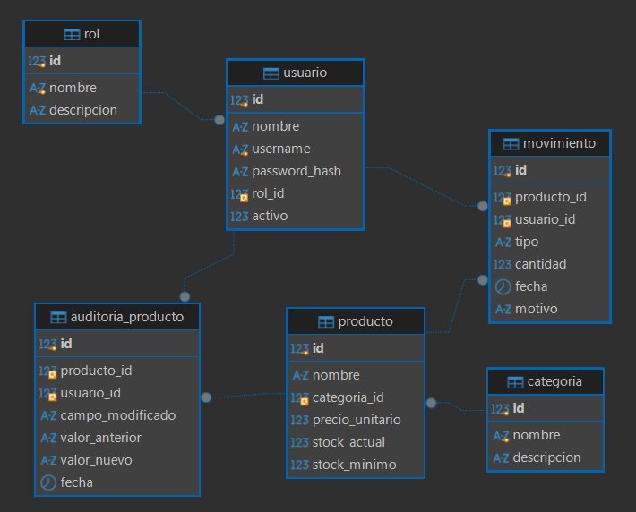

# Sistema de Gestión de Inventario

Aplicación web Full Stack para el control de existencias, alertas de reposición, auditoría de cambios y registro de movimientos de entrada y salida.

- **Prototipo UX/UI:** [Ver diseño en Figma](https://www.figma.com/make/nz5KLWv7owt4taoPxRcNU4/Dashboard-de-Inventario?fullscreen=1&t=yJXnACmGCndWgoij-1&code-node-id=0-6)
- **Documentación de API (Swagger):** `http://localhost:8000/docs` (al levantar el entorno)

---

## Ejecución Rápida con Docker

Con **Docker Desktop** instalado y en ejecución, desde la raíz del proyecto:

```bash
docker compose up --build
```

### Servicios disponibles

- **Frontend (React + Vite):** http://localhost:5173
- **Backend (FastAPI):** http://localhost:8000
- **Documentación interactiva de la API:** http://localhost:8000/docs
- **Base de datos (MySQL):** `localhost:3307` (base de datos: `inventario_db`)

### Notas sobre el entorno local

- La base de datos se inicializa automáticamente con `database/schema.sql` y `database/seed.sql` la primera vez que se crea el volumen.
- Para detener los servicios:
  ```bash
  docker compose down
  ```
- Para borrar también el volumen de la base de datos y reinicializarla desde cero:
  ```bash
  docker compose down -v
  ```
- *Nota:* Actualmente el frontend funciona con datos centralizados (`inventarioMock.js`) para demostración visual e interactiva, y las credenciales incluidas en `docker-compose.yml` son exclusivas para desarrollo local.

---

## Stack Tecnológico

- **Frontend:** React (Vite), CSS modular por componente, Recharts, Lucide React.
- **Backend:** Python, FastAPI, Pydantic, SQLAlchemy (Arquitectura en capas).
- **Base de Datos:** MySQL (Relacional).
- **Infraestructura:** Docker & Docker Compose.

---

## 1. Base de Datos y Modelo Entidad-Relación



### 1.1 Diseño del Modelo y Decisiones

- **¿Por qué SQL relacional (MySQL / PostgreSQL)?**
  El dominio de inventario maneja relaciones estrictas (`rol 1:N usuario`, `categoria 1:N producto`, `producto 1:N movimiento`, `producto 1:N auditoria_producto`). Se requiere transaccionalidad **ACID** para garantizar que el registro de un movimiento y la actualización del stock ocurran de forma atómica.
  - *Frente a NoSQL (MongoDB):* En este dominio la integridad referencial y la consistencia transaccional pesan más que un esquema flexible.
  - *Frente a SQLite:* SQLite es útil para pruebas locales aisladas, pero para concurrencia real con múltiples operadores se requiere un motor cliente-servidor como MySQL o PostgreSQL.
- **Uso de ORM (SQLAlchemy):**
  Acelera el desarrollo CRUD, protege contra inyección SQL mediante consultas parametrizadas y facilita el versionado de esquema con migraciones (Alembic), reservando SQL nativo únicamente para consultas analíticas complejas donde se requiera evitar problemas como consultas **N+1**.
- **Blindaje contra stock negativo (Estrategia en 3 capas):**
  1. **Base de datos:** Restricción `CHECK (stock_actual >= 0)` en la tabla `producto`.
  2. **Transacción / Concurrencia:** Operaciones atómicas con bloqueo de fila (`SELECT ... FOR UPDATE`) para evitar condiciones de carrera (*race conditions*) ante salidas simultáneas.
  3. **Aplicación:** Validación previa en la capa de servicios del backend y validación preventiva en el formulario del cliente.

### 1.2 Trazabilidad y Auditoría de Cambios

- **Tabla `auditoria_producto`:** Registra `producto_id`, `usuario_id`, `campo_modificado` (ej. `precio_unitario`, `nombre`), `valor_anterior`, `valor_nuevo` y `fecha`.
- **Por qué en tabla separada:** Mantiene la tabla operativa `producto` liviana y rápida para las consultas diarias del inventario, conservando el historial intacto sin ensuciar los datos activos.

### 1.3 Escalabilidad a Futuro (Contexto Conceptual)

- **Alto volumen (500.000+ productos y miles de movimientos diarios):** Indexación en claves foráneas (`producto_id`, `usuario_id`) y fechas (`fecha`), paginación por cursor (`WHERE id > ultimo_id`) en lugar de `OFFSET` masivos, y particionamiento por rangos de fecha en la tabla `movimiento`.
- **Stock histórico a una fecha pasada:** Implementación de tablas de saldos consolidados periódicos (*snapshots* diarios/mensuales) para calcular el stock a partir del corte más cercano sin recalcular toda la historia desde el día uno.

---

## 2. Arquitectura Backend

### 2.1 Organización en Capas (FastAPI)

El backend sigue una separación estricta de responsabilidades para facilitar el mantenimiento y las pruebas:

- `/routers`: Recepción de peticiones HTTP, validación de esquemas con **Pydantic** y respuestas de estado.
- `/services`: Lógica de negocio pura (validación de stock disponible, cálculo de movimientos, reglas de negocio).
- `/repositories`: Encapsulamiento de consultas y transacciones contra la base de datos mediante SQLAlchemy.
- `/models`: Definición de entidades relacionales (`rol`, `usuario`, `categoria`, `producto`, `movimiento`, `auditoria_producto`).

### 2.2 Seguridad y Logs

- **Roles y Autenticación:** Tabla `rol` vinculada a `usuario` (`password_hash` cifrado con **Bcrypt/Argon2**, nunca en texto plano) y protección de endpoints mediante tokens **JWT** (`Authorization: Bearer <token>`).
- **Logs vs. Auditoría de negocio:** Los logs técnicos (`logging` rotativo en Python) registran excepciones y eventos de infraestructura para soporte/debugging, mientras que `auditoria_producto` y `movimiento` registran eventos funcionales con valor operativo y contable.

---

## 3. Diseño Frontend y Decisiones UX/UI

### 3.1 Elección de React SPA frente a Streamlit

Se optó por **React (Vite)** en lugar de herramientas de prototipado rápido en Python (como Streamlit) porque un sistema transaccional de inventario exige control fino de la interfaz, modales interactivos, filtros dinámicos sin recargas, validaciones en tiempo real en el cliente y una arquitectura modular escalable.

### 3.2 Pantallas y Decisiones de Interfaz

1. **Vista Resumen (Dashboard):**
   - **Tarjetas KPI:** Calculan dinámicamente el total de productos, unidades físicas en stock, alertas críticas y valorización económica del inventario.
   - **Gráfico de barras por categoría (Recharts):** Se eligió **Recharts** por su integración declarativa con React, soporte responsivo (`ResponsiveContainer`), tooltips interactivos y líneas guía horizontales (`CartesianGrid`) estilizadas con las variables CSS del sistema.
   - **Panel agrupado de alertas:** Concentra los productos con `stock_actual <= stock_minimo` en un único bloque informativo para evitar la fatiga visual de notificaciones o pop-ups intrusivos.
2. **Catálogo de Productos (`TablaProductos`):**
   - Búsqueda en tiempo real por nombre o código, filtro por categoría e indicadores visuales condicionales (badges) para identificar rápidamente existencias críticas.
3. **Modal de Registro de Movimiento (`ModalMovimiento`):**
   - **Contexto enfocado y Ley de Fitts:** Modal centrado con botones de acción al pie (**Cancelar** a la izquierda como acción secundaria y **Confirmar movimiento** a la derecha como acción primaria).
   - **Validación desacoplada:** La lógica de validación reside en `src/utils/validaciones.js` (separada de la vista) para impedir cantidades menores o iguales a cero y salidas que superen el stock disponible antes de enviar el formulario.
   - **Trazabilidad de sesión:** Muestra el usuario autenticado de forma informativa y no editable.
4. **Arquitectura CSS Modular:**
   - Tokens y variables globales en `index.css` acompañados de hojas de estilo dedicadas por cada componente (`Sidebar.css`, `Header.css`, `ModalMovimiento.css`, etc.).

---

## 4. Uso de Inteligencia Artificial en el Desarrollo

Durante el ciclo de desarrollo se utilizaron herramientas de IA como apoyo técnico y de diseño bajo revisión y criterio propio:

- **Gemini:** Debate de arquitectura en capas, modelado relacional, manejo de concurrencia, modularización de componentes en React.
- **GitHub Copilot (VS Code) y Claude:** Asistencia en la escritura incremental de código, estilos CSS modulares y refactorización.
- **Búsqueda con IA de Google:** Investigación rápida de documentación y comparativa de tecnologías (motores SQL, librerías de gráficos en React).
- **Figma Make:** Generación de un prototipo visual inicial del dashboard a partir de los requerimientos UX/UI antes de implementarlo en código.

### Decisiones ajustadas a partir del análisis con IA

1. **MySQL vs. PostgreSQL:** El análisis comparativo permitió comprender las fortalezas de cada motor relacional y fundamentar su elección frente a alternativas NoSQL o SQLite.
2. **React SPA vs. Streamlit:** Se priorizó la experiencia transaccional, el control visual y las validaciones en cliente de React por sobre la velocidad de prototipado de Streamlit.
3. **Gráfico de barras (CSS puro vs. Recharts):** Aunque inicialmente se planteó resolver el gráfico únicamente con CSS puro, se incorporó **Recharts** para brindar interactividad nativa (tooltips, cuadrícula de lectura) y escalabilidad para futuros reportes.